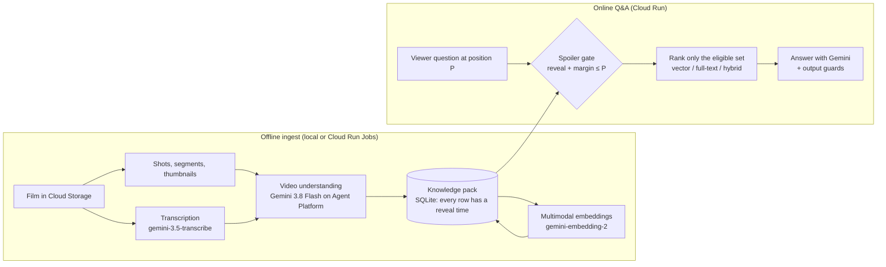

# Hello Watch Assistant

**A spoiler-free viewing companion built on Gemini and Google Cloud.**

Pause a film at any moment and ask *"Who is she?"*, *"What is that thing?"*, *"What did I miss?"* or
*"What did he just say?"*. The assistant only answers from what you have already seen. It never names a character
before the film does, never hints at a twist, and never says an actor's name.

> Built for the Google Cloud AI Builder Cup 2026 (Media, Content & Digital Experiences track).
> Development started on 2026-10-09, within the hackathon window.

**Live demo: DEMO_URL** — pick a film, pause anywhere, ask. The second tab ("How it works") is an interactive map of
the whole pipeline and the Google Cloud services behind it.

---

## Why this is hard

A general chatbot knows the whole film, from Wikipedia, reviews and its training data. Asked *"who is the old man?"*
at minute 12, it will happily explain the reveal from minute 80. Spoiler safety cannot be a polite instruction
to the model. It has to be **structural**: the model must never *see* what the viewer hasn't seen yet.

## How it works



1. **Ingest (offline, once per film).** A pipeline of cached, budgeted stages turns a film into a *knowledge pack*:
   characters (with the moment their name is first revealed), looks, facts, scenes, events, objects, dialogue cues,
   plus v1.1 additions inspired by recent movie-understanding research:
   - **In-film character bank.** 1–3 reference frames per character, checked by drawing a red circle on the frame
     and asking Gemini to confirm the circled subject (visual prompting, after AutoAD-II / AutoAD-Zero).
   - **Shot-level captions** with on-screen entities, positions and bounding boxes, so a viewer can tap the screen
     and ask "who is that on the left?" (after Shot-by-Shot).
   - **Speaker attribution.** Diarization combined with visual judgement (lips, shot / reverse shot), with a
     weighted vote per speaker cluster.
   - **Progressive recaps** ("story so far" at every scene end). Each recap is generated *only* from facts visible at
     that moment, then re-checked for names that aren't visible yet (after MovieChat's breakpoint mode).
   - **Multimodal embeddings** with `gemini-embedding-2`: text items, plus ≤30 s video windows with audio read
     directly from `gs://`.
2. **Gate, then rank.** Every row carries a `reveal_at_s`. At playback position *P* the service first computes the
   *eligible set* (`reveal_at_s + margin ≤ P`, with type-specific margins and name-visibility rules). Only then does it
   rank by vector similarity, full-text or reciprocal-rank fusion. Retrieval can't leak what the gate removed, because
   ranking never sees it. (This is why managed RAG with metadata filters was rejected: a filter that silently fails
   would be a spoiler.)
3. **Answer, then guard.** Answers are generated from the eligible evidence plus a short "near window" of the video
   before *P*. Output guards then check them against a real-person-name blocklist, future "canary" terms and
   name-visibility rules.

The full contract is in [docs/knowledge-pack.md](docs/knowledge-pack.md). How the online service uses it is in
[docs/online-qa.md](docs/online-qa.md).

## Google Cloud and Gemini usage

| Capability | Google technology | Where |
|---|---|---|
| Video understanding: structure, characters, shots, speakers, recaps | **Gemini 3.8 Flash** on **Gemini Enterprise Agent Platform** (`genai.Client(enterprise=True)`), videos read from `gs://` | `ingest/stages/`, `ingest/recaps.py` |
| Speech transcription with diarization | **gemini-3.5-transcribe** (Gemini Developer API) | `ingest/stages/gemini_stages.py` |
| Multimodal retrieval (text, and video with audio) | **gemini-embedding-2** (1536-d) | `ingest/embed.py`, `ingest/retrieval.py` |
| Batch ingest | **Cloud Run Jobs** (parallel tasks, one asset per task) | `ingest/cloud/`, `deploy/ingest/` |
| Media and pack storage | **Cloud Storage** (assets, work dirs, versioned packs) | `ingest/cloud/gcs.py` |
| Image build | **Cloud Build** + **Artifact Registry** (pinned FFmpeg / Python for byte-reproducible packs) | `deploy/ingest/` |
| Secrets: API key and **all prompts** | **Secret Manager** (prompts are never baked into the image) | `ingest/promptbook.py`, `deploy/prompts/` |
| Upload renewal | **Cloud Scheduler** → Cloud Run Job | `deploy/ingest/renew-job.yaml` |
| Online assistant: tool-using agent with gate-aware tools, streamed to the browser | **Agent Development Kit (ADK)** `LlmAgent` on **Gemini 3.8 Flash** (Agent Platform), served by **Cloud Run** | `server/`, `web/`, `deploy/web/` |
| Playback | **Cloud Storage** V4 signed URLs, signed by the service's own identity (IAM `signBlob`, no key files) | `server/main.py` |

## Prompts: open code, private know-how

The code in this repository is complete and runnable. The **production prompts are not in it**.
`ingest/promptbook.py` loads every prompt at runtime, in this order:

1. `CEDAR_PROMPTS_SECRET`: a Secret Manager version (`projects/<p>/secrets/<name>/versions/latest`), read with
   Application Default Credentials. Cloud Run Jobs use this.
2. `CEDAR_PROMPTS_DIR`: a local directory with one `<name>.txt` per prompt.
3. [`prompts/`](prompts/): **simplified reference prompts**, so the pipeline runs end to end out of the box.

Each prompt's placeholders are validated on load, so a broken secret fails fast instead of producing bad packs.
`deploy/prompts/push_prompts.sh` bundles a prompt directory into a new secret version.

## Results on the demo films

All three films are processed end to end with the v1.1 pipeline:

| Film | Shot captions / entities | Speaker-attributed cues | Recaps | Video windows | Embeddings |
|---|---|---|---|---|---|
| Sintel | 175 / 283 | 104 / 104 | 10 | 40 | ~405 |
| Tears of Steel | 138 / 235 | 93 / 95 | 12 | 32 | ~343 |
| Elephants Dream | 122 / 225 | 92 / 93 | 10 | 29 | ~305 |

Spot checks on Sintel:
- Shot captions: about 85% fully correct.
- Character identity in shot entities: 12/12.
- Speaker attribution: 10/10.
- Retrieval (20 questions × 2 positions, top-3 time overlap): vector 36/40, full-text only 22/40.
  Chinese questions: vector 12/14, full-text 0.
- **0 gate violations** in 120 checked retrieval results.

Total Gemini cost for the three films, including all re-runs: about $8.

## Repository layout

| Path | What |
|---|---|
| `ingest/` | Ingest pipeline: stages, pack assembly, builder checks, recaps, embeddings, gate-then-rank retrieval. See [ingest/README.md](ingest/README.md) |
| `ingest/cloud/`, `deploy/ingest/` | Cloud Run Jobs runner, GCS layout, image build and job specs. See [docs/cloud-deploy.md](docs/cloud-deploy.md) |
| `ingest/promptbook.py`, `prompts/`, `deploy/prompts/` | Runtime prompt loading (Secret Manager), reference prompts |
| `schema/` | Knowledge-pack SQLite DDL and the shared normalisation wordlists |
| `server/` | Online Q&A service: FastAPI + ADK agent, gate-first views at P (`knowledge.py`), output guards (`guard.py`). Contract: [docs/web-api.md](docs/web-api.md) |
| `web/` | Static front end: "Live demo" player tab and the interactive "How it works" tab |
| `deploy/web/` | Web service image and Cloud Run deployment (service account, prompt secret, limits) |
| `catalog/` | Demo catalog (the three open films) |
| `docs/` | [Knowledge-pack spec](docs/knowledge-pack.md), [online Q&A guide](docs/online-qa.md), [cloud deployment](docs/cloud-deploy.md) |

## Quick start (local)

Requirements: Python 3.13, `ffmpeg` / `ffprobe`, and a Gemini API key or Google Cloud ADC.

```bash
python -m venv .venv && .venv/bin/pip install -r requirements-ingest.txt
.venv/bin/python -m pytest -q                       # unit tests; no network, placeholder prompts

# ingest one film (stages are cached and budgeted; see ingest/README.md)
.venv/bin/python -m ingest run --asset /path/to/sintel.mp4 --catalog-id c4c02a81-ae5c-4a91-aef1-eea196f91c17
.venv/bin/python -m ingest check                    # builder checks on the master pack
```

To use Agent Platform instead of the Developer API, set `CEDAR_GEMINI_BACKEND=enterprise` and
`CEDAR_GCP_PROJECT=<project>`. Cloud deployment is described in [docs/cloud-deploy.md](docs/cloud-deploy.md).

### Web demo (local)

```bash
.venv/bin/pip install -r requirements-web.txt
export CEDAR_GCP_PROJECT=<project> CEDAR_GEMINI_BACKEND=enterprise
export WATCH_PACKS_DIR=<dir with <asset_sha>/master/pack.db>   # or WATCH_PACKS_GCS=gs://<bucket>/<prefix>
export WATCH_VIDEO_DIR=<dir with <asset_sha>.mp4>               # or CEDAR_INGEST_BUCKET=<bucket> for signed URLs
.venv/bin/uvicorn server.main:app --port 8080                   # then open http://localhost:8080
```

Deploy to Cloud Run: `PROJECT=<project> BUCKET=<bucket> PROMPTS_DIR=<agent prompts> deploy/web/deploy.sh`.

## Research this builds on

- AutoAD II: *The Sequel – Who, When, and What in Movie Audio Description* (in-film character bank).
- AutoAD-Zero: *A Training-Free Framework for Zero-Shot Audio Description* (circle visual prompting).
- Shot-by-Shot: *Film-Grammar-Aware Training-Free Audio Description Generation* (shot-level description).
- MovieChat: *From Dense Token to Sparse Memory for Long Video Understanding* (breakpoint mode, long-term memory).
- Speaker-aware long-video QA, including HAVEN (speaker labels; search → inspect → answer).

## Demo films and attribution

The demo uses only openly licensed films by the Blender Foundation:

- **Sintel**: © Blender Foundation, [durian.blender.org](https://durian.blender.org), CC BY 3.0
- **Tears of Steel**: © Blender Foundation, [mango.blender.org](https://mango.blender.org), CC BY 3.0
- **Elephants Dream**: © 2006 Blender Foundation / Netherlands Media Art Institute,
  [orange.blender.org](https://orange.blender.org), CC BY 2.5

The films are not stored in this repository.

## License

[MIT](LICENSE)
